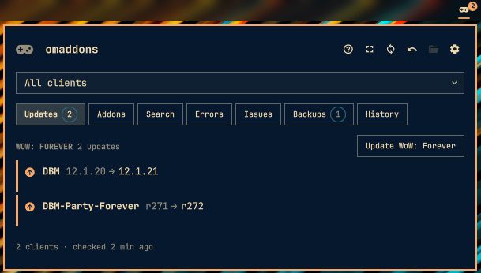
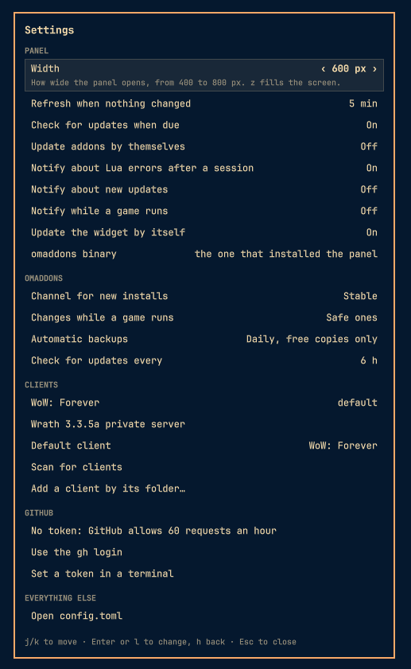
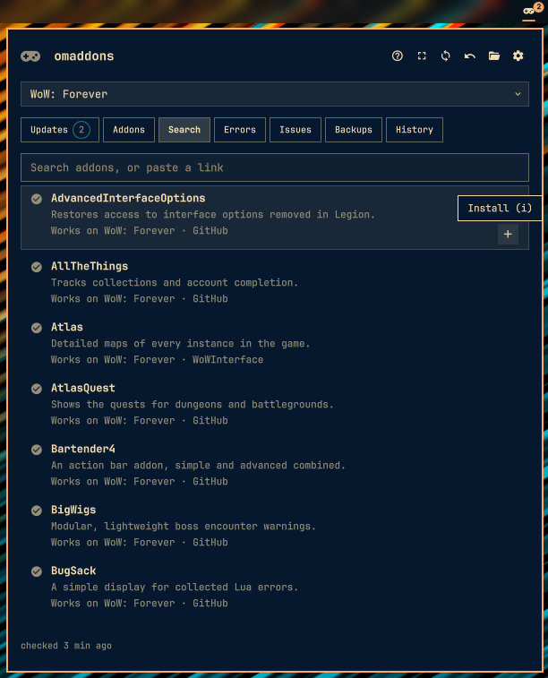
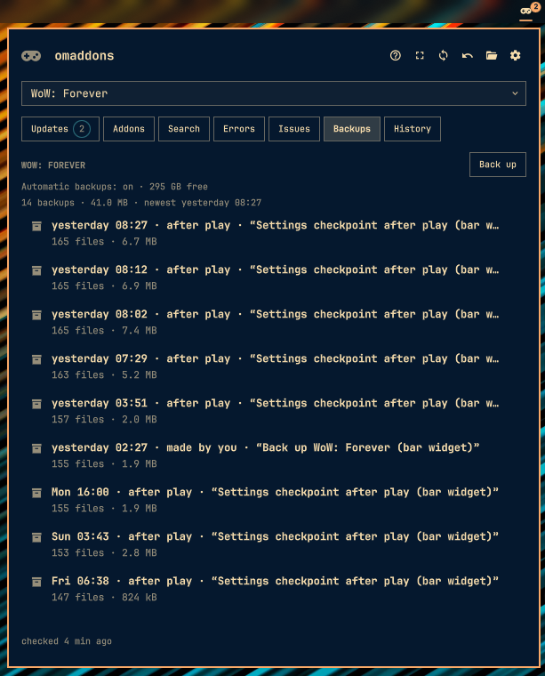

# omaddons for Omarchy

The Omarchy bar widget for [omaddons](https://github.com/a44-io/omaddons), a World of Warcraft addon manager for Linux. It finds every WoW client on the machine and shows pending addon updates, Lua errors and WTF backups. Every change it makes can be undone.

<table>
<tr>
<td valign="top" width="50%">


</td>
<td valign="top" width="50%">


</td>
</tr>
</table>

This repository holds the setup button, not the widget itself. The omaddons program renders the widget for your machine: the widget records where omaddons lives and stays at the same version, so it can't be a plain git checkout. The button installs omaddons if you don't have it, then installs the widget, which takes the button's place on the bar.

## Install

```bash
omarchy plugin add https://github.com/a44-io/omaddons-omarchy.git --enable
```

Click the gamepad on the bar. Its panel says what it found and offers one button: **Install omaddons 0.2.1 and the widget**, or **Install the widget** when that release is already installed. The button:

1. Asks mise where omaddons 0.2.1 is installed (`mise where`, which is local and offline), and hashes its binary.
2. If it isn't installed, installs exactly that release with mise, then hashes the downloaded binary:

   ```bash
   mise use -g github:a44-io/omaddons@0.2.1
   ```

   When another omaddons is already on your `PATH`, it runs `mise install github:a44-io/omaddons@0.2.1` instead, so your own mise configuration stays as it is.
3. Runs that verified binary's `omarchy install`. That puts the widget in this plugin's folder, `~/.config/omarchy/plugins/a44.omaddons`, and reloads Omarchy's plugins. The widget appears where the button was.

If anything fails, the panel shows mise's or omaddons' own message, with **Try again** and **Copy command** for doing it by hand.

Already have omaddons? `omaddons omarchy install` does the same without this plugin. The button never runs an omaddons it did not verify.

## The pinned release

The button installs and runs one omaddons release. That release is pinned in `BarWidget.qml`, together with the SHA-256 of its `omaddons` binary:

| | |
|---|---|
| Release | [`v0.2.1`](https://github.com/a44-io/omaddons/releases/tag/v0.2.1) |
| Binary SHA-256 | `0b0353001971176dc2ef6e545193962c11bed65c9ecd4e30ddcc38ce5c18091b` |

Before it runs anything, the button hashes the installed binary and compares it with the pinned digest. On a mismatch it refuses: the panel shows both digests and runs nothing. What runs on your machine is therefore fixed by this repository's reviewed commit. The button never runs a later release, or a release someone replaced. To check the pin yourself:

```bash
curl -fsSLO https://github.com/a44-io/omaddons/releases/download/v0.2.1/omaddons-0.2.1-x86_64-unknown-linux-gnu.tar.gz
tar xzf omaddons-0.2.1-x86_64-unknown-linux-gnu.tar.gz omaddons && sha256sum omaddons
```

The release is built from the `v0.2.1` tag of [a44-io/omaddons](https://github.com/a44-io/omaddons) by its `scripts/release.sh`.

## Requirements

- Omarchy with shell plugin support. Omarchy activates mise in your shell and your desktop session, which is what puts `omaddons` on your `PATH`.
- Linux on x86_64, the platform omaddons releases are built for.
- mise, which Omarchy ships.

## Updating

Once installed, the widget is no longer this button. omaddons renders it, and the widget updates itself whenever omaddons is upgraded. `omarchy plugin update` has nothing to do for it, because it is not a git checkout.

omaddons upgrades only when you ask it to, with `mise use -g github:a44-io/omaddons@latest` (or a specific version). The widget then notices the new version and reinstalls itself from it.

When omaddons publishes a release, this repository moves its pin in a commit that the Omarchy plugin marketplace reviews before publishing. Until then, new installs keep getting the pinned release.

## Removal

```bash
omarchy plugin remove a44.omaddons --yes
```

This removes the button, or the widget once it is installed. `omaddons omarchy remove` also removes the widget, and records the removal in omaddons' history.

Neither command uninstalls omaddons itself. If this button installed it, remove it with:

```bash
mise unuse -g github:a44-io/omaddons            # out of mise's global configuration
mise uninstall --all github:a44-io/omaddons     # and off the disk
```

If the button installed it beside another omaddons, the second command alone is enough.

## What it runs

The button has no network access of its own: mise downloads the release from GitHub. It never uses sudo. It runs only these commands, each as an argument list:

```text
sh -c <fixed probe> sh github:a44-io/omaddons@0.2.1   # mise where, then sha256sum of that binary; command -v omaddons, only to name it
mise use -g github:a44-io/omaddons@0.2.1              # only when 0.2.1 is not installed (mise install … beside another omaddons)
setsid -w <verified binary> --actor widget --reason "setup plugin" omarchy install
omarchy-shell shell rescanPlugins                     # only if the shell hasn't picked up the widget after 15 s
wl-copy -- <command>                                  # Copy command, after a failure
```

The probe is a fixed script, and the pinned tool reaches it as an argument. It runs no omaddons: an omaddons found on your `PATH` is only named in the panel.

Scripts and agents can drive the button over IPC:

```bash
omarchy-shell a44.omaddons.setup state   # {"phase": "ready", "pinned": "github:a44-io/omaddons@0.2.1", "sha256": …, "binary": …}
omarchy-shell a44.omaddons.setup setUp   # the same as pressing the panel's button
omarchy-shell a44.omaddons.setup check   # look again
```

`setsid -w` runs the install in a session of its own. The install replaces this button, which unloads it, and the separate session lets the install finish anyway. If the install fails, its message still reaches the panel.

## Moving the pin

When a44-io/omaddons publishes a release:

1. `argc release vX.Y.Z` in a44-io/omaddons prints the new binary's SHA-256. Check it against the published tarball, as above.
2. In `BarWidget.qml`, set `pinnedVersion` and `pinnedSha256`. Set the same values in `tests/tst_setup.qml` and in this README's table and commands.
3. Run `tests/run.sh` and `omarchy-plugin-validate .`, then commit and push.
4. Ask the marketplace to publish the new commit with its [verify form](https://github.com/omacom/omarchy-plugin-marketplace/issues/new?template=verify-plugin.yml): **Verify and publish a newer upstream commit**, with the full SHA of the new HEAD.

## License

MIT. See [LICENSE](LICENSE).
