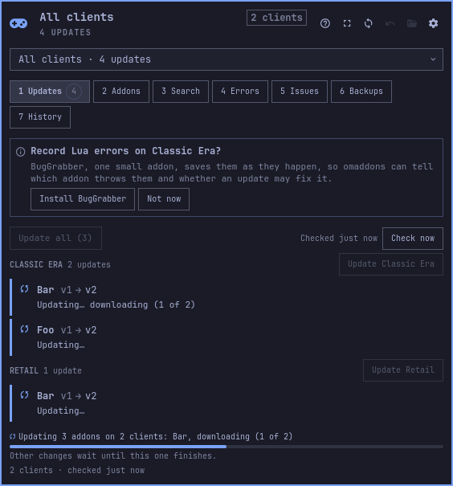

# omaddons for Omarchy

The Omarchy bar widget for [omaddons](https://github.com/a44-io/omaddons), a World of Warcraft addon manager for Linux. It finds every WoW client on the machine and shows pending addon updates, Lua errors and WTF backups. Every change it makes can be undone.



This repository holds the setup button, not the widget itself. The omaddons program renders the widget for your machine: the widget records where omaddons lives and stays at the same version, so it can't be a plain git checkout. The button installs omaddons if you don't have it, then installs the widget, which takes the button's place on the bar.

## Install

```bash
omarchy plugin add https://github.com/a44-io/omaddons-omarchy.git --enable
```

Click the gamepad on the bar. Its panel says what it found and offers one button (**Install the widget**, or **Install omaddons and the widget** when you don't have omaddons yet). That button:

1. Looks for omaddons in `~/.local/bin`, then on your `PATH`, and checks that it can install this widget.
2. If omaddons is missing or too old, installs it with Omarchy's mise installer, the way Omarchy installs other CLI tools:

   ```bash
   omarchy-mise-install github:a44-io/omaddons omaddons
   ```

   This puts a small wrapper at `~/.local/bin/omaddons`. The wrapper downloads omaddons from its GitHub releases and keeps it current.
3. Runs `omaddons omarchy install`. That puts the widget in this plugin's folder, `~/.config/omarchy/plugins/a44.omaddons`, and reloads Omarchy's plugins. The widget appears where the button was.

If anything fails, the panel shows omaddons' own message, with **Try again** and **Copy command** for doing it by hand.

Already have omaddons? `omaddons omarchy install` does the same thing without this plugin.

## Requirements

- Omarchy with shell plugin support.
- Linux on x86_64, the platform omaddons releases are built for.
- mise, which Omarchy ships, if omaddons isn't installed yet.

## Updating

The widget updates itself with omaddons. When omaddons is upgraded, the widget notices the new version and reinstalls itself from it, so you never update the two separately. `omarchy plugin update` has nothing to do once the widget is installed, because the widget is no longer a git checkout.

An omaddons installed by this button upgrades when you run `omaddons` in a terminal (the mise wrapper checks for new releases), or with `mise upgrade`.

## Removal

```bash
omarchy plugin remove a44.omaddons --yes
```

This removes the button, or the widget once it is installed. `omaddons omarchy remove` also removes the widget, and records the removal in omaddons' history.

Neither command uninstalls omaddons itself. If this button installed it, remove omaddons with:

```bash
mise unuse -g github:a44-io/omaddons
rm ~/.local/bin/omaddons
```

## What it runs

The button has no network access of its own. mise downloads omaddons from GitHub. The button runs only these commands, each as an argument list:

```text
sh -c <fixed probe>                 # finds omaddons: ~/.local/bin/omaddons, then PATH
omaddons omarchy status --json      # where this omaddons installs the widget
omarchy-mise-install github:a44-io/omaddons omaddons   # only when omaddons is missing or too old
rm -f -- ~/.local/bin/omaddons      # only a wrapper it just created that then failed to download
setsid -w omaddons --actor widget --reason "setup plugin" omarchy install
omarchy-shell shell rescanPlugins   # only if the shell hasn't picked up the widget after 15 s
wl-copy -- <command>                # Copy command, after a failure
```

The probe tries each omaddons it finds, so a wrapper that can't download (offline, say) never hides a working omaddons on your `PATH`. If the button's own mise install fails, the wrapper it just created is removed. A broken wrapper would otherwise shadow a working omaddons in your terminal.

Scripts and agents can drive the button over IPC:

```bash
omarchy-shell a44.omaddons.setup state   # {"phase": "ready", "binary": …, "version": …}
omarchy-shell a44.omaddons.setup setUp   # the same as clicking Set up
omarchy-shell a44.omaddons.setup check   # look for omaddons again
```

`setsid -w` runs the install in a session of its own. The install replaces this button, which unloads it, and the separate session lets the install finish anyway. If the install fails, its message still reaches the panel.

## License

MIT. See [LICENSE](LICENSE).
